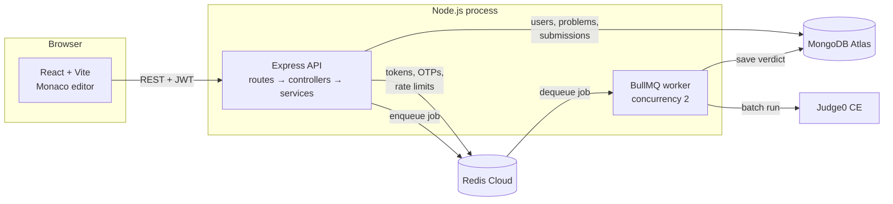
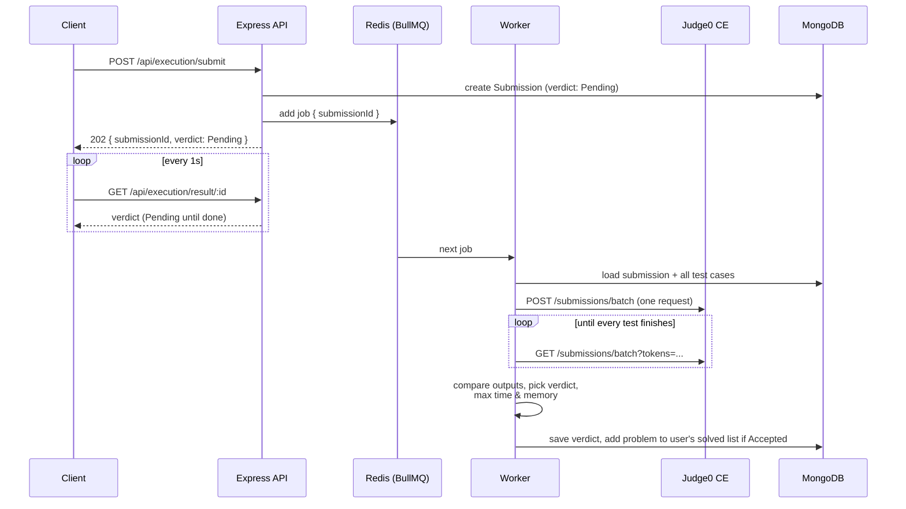

# CodeHub

A LeetCode-style online judge. Users browse coding problems, write solutions in an in-browser VS Code editor, run them against sample tests, and submit them to be judged against hidden test cases. Each submission gets a verdict, runtime and memory usage.

**Status:** v2. It adds profile photo uploads with Cloudinary; see [VERSION_2.md](VERSION_2.md) for what changed since v1. Built as a full-stack learning and portfolio project, designed to run entirely on free tiers.

---

## Features

**Coding workspace**
- Monaco editor (the editor behind VS Code) with starter code for each language
- 5 languages: JavaScript (Node 22), Python 3.12, Java 17, C++ (GCC 14), C (GCC 14)
- **Run** executes your code against the visible sample tests and shows input, expected and actual output for each case
- **Submit** judges your code against all visible and hidden tests and returns one of: `Accepted`, `Wrong Answer`, `Time Limit Exceeded`, `Runtime Error`, `Compilation Error`, `Internal Error`
- Resizable split panes (description | editor / console), plus submission history for each problem

**Problems**
- Catalog of 20 seeded classic problems (Two Sum, Valid Parentheses, 3Sum, Trapping Rain Water, ...)
- Search by title, filter by difficulty and tags, pagination, solved/unsolved markers
- Admin-only create, update and delete

**Accounts and profiles**
- Register and log in with a username or email
- Email verification with a 6-digit OTP (printed to the server console when email isn't configured)
- Public profile at `/u/:username`: solved count by difficulty, submission stats, activity heatmap, recent accepted problems
- Profile photo upload: resized in the browser, uploaded straight to Cloudinary with a server-signed request, and shown at the right size everywhere. Users without a photo see their initial.
- Edit profile (name, bio, preferred languages), change password, delete account

**Backend engineering**
- **Asynchronous judging:** submissions go into a BullMQ queue and a background worker judges them, so the API responds right away
- **Batch execution:** all test cases for a submission go to Judge0 in a single batch request
- **Retries:** failed judge jobs retry 3 times with exponential backoff (2s, 4s, 8s). After the last retry the submission is marked `Internal Error` instead of being blamed on the user's code
- **JWT auth with refresh-token rotation:** 15-minute access tokens, 7-day refresh tokens in an httpOnly cookie, and a Redis blacklist so logout takes effect immediately
- **Redis rate limiting** on login, register, token refresh, run, submit and OTP endpoints
- **Graceful shutdown:** on `SIGTERM`/`SIGINT` the server stops accepting requests, lets the worker finish its current job, then closes Redis and MongoDB

---

## Tech Stack

| Layer | Technology |
|---|---|
| **Backend** | Node.js, Express 5 |
| **Database** | MongoDB Atlas + Mongoose 9 |
| **Cache / queue** | Redis Cloud, BullMQ (ioredis) and node-redis |
| **Code execution** | [Judge0 CE](https://ce.judge0.com) (sandboxed, public API) |
| **Auth** | JSON Web Tokens, bcrypt, httpOnly cookies |
| **Validation** | Zod (server and client) |
| **Email** | Nodemailer |
| **Image storage** | Cloudinary (signed direct uploads, on-the-fly resizing) |
| **Frontend** | React 19, Vite 8, React Router 7 |
| **State** | Redux Toolkit |
| **Editor** | Monaco (`@monaco-editor/react`), `react-resizable-panels` |
| **Forms** | react-hook-form + Zod |
| **Styling** | Tailwind CSS 4, daisyUI 5 |
| **HTTP** | Axios, with automatic token-refresh interceptor |

---

## Architecture



The API and the queue worker run in the **same Node process**, which keeps deployment to one service. The backend follows a layered design: **routes** → **middleware** (auth, rate limits) → **controllers** (HTTP in/out) → **services** (business logic) → **models**.

### How a submission is judged



Each job carries only a `submissionId`. The code and test cases stay in MongoDB, which keeps Redis memory small on the free plan.

### What lives in Redis

Every key except BullMQ's has an expiry, so Redis cleans up after itself.

| Key | Purpose | TTL |
|---|---|---|
| `refreshToken:<userId>` | Currently valid refresh token (rotated on each refresh) | 7 days |
| `blacklist:<accessToken>` | Access tokens revoked by logout | Token's remaining life (≤ 15 min) |
| `email_otp:<userId>` | Email verification code | 10 min |
| `email_cooldown:<userId>` | Prevents OTP resend spam | 60 s |
| `ratelimit:<action>:<user or IP>` | Rate-limit counters | Limiter window |
| `bull:submissions:*` | BullMQ queue state | Last 100 completed / failed jobs kept |

---

## Project Structure

```
Codehub/
├── backend/
│   ├── .env.example              # Environment variable template
│   └── src/
│       ├── index.js              # Entry point: Express app, DB + Redis connect, worker, shutdown
│       ├── config/               # MongoDB, Redis and BullMQ connections
│       ├── routes/               # auth, problems, execution, user
│       ├── middleware/           # JWT auth / admin auth, Redis rate limiter
│       ├── controllers/          # HTTP layer
│       ├── services/             # Business logic (auth, problems, execution, profile, email)
│       ├── models/               # User, Problem, Submission
│       ├── queues/               # BullMQ submission queue
│       ├── workers/              # Submission judging worker
│       └── utils/                # Judge0 client, JWT, hashing, zod schemas, seed scripts
└── Frontend/
    └── src/
        ├── App.jsx               # Routes + auth guard
        ├── api/                  # Axios instance, refresh logic, execution API
        ├── store/                # Redux store, auth slice
        ├── pages/                # homepage, problem, profile, login, signup
        ├── components/           # Navbar, filters, table, problem/ and profile/ panels
        └── constants/            # Supported languages, problem constants
```

---

## Getting Started

### Prerequisites

- **Node.js 20+**
- A **MongoDB Atlas** cluster (free M0 tier works)
- A **Redis Cloud** database (free 30 MB tier works). Set its eviction policy to **`noeviction`**, or Redis may delete BullMQ's queue keys when memory runs low.
- Internet access (submissions run on the public Judge0 CE API, so you don't need an API key or Docker)

### 1. Clone and install

```bash
git clone git@github.com:JatinRawal30/CodeHub.git
cd CodeHub

cd backend  && npm install
cd ../Frontend && npm install
```

### 2. Configure environment variables

```bash
cp backend/.env.example backend/.env
```

| Variable | Required | Description |
|---|---|---|
| `PORT` | yes | API port. The frontend expects `3200`. |
| `DB_URI` | yes | MongoDB connection string |
| `JWT_KEY` | yes | Secret for signing access tokens |
| `REFRESH_KEY` | yes | Separate secret for refresh tokens |
| `REDIS_HOST` | yes | Redis Cloud host |
| `REDIS_PORT` | yes | Redis Cloud port |
| `REDIS_KEY` | yes | Redis Cloud password |
| `EMAIL_USER` / `EMAIL_PASS` | no | SMTP credentials (for Gmail, use an App Password) |
| `EMAIL_SERVICE` | no | Nodemailer service, for example `gmail` |
| `EMAIL_FROM` | no | Sender address |
| `CLOUDINARY_CLOUD_NAME` | for photos | Cloudinary cloud name |
| `CLOUDINARY_API_KEY` | for photos | Cloudinary API key |
| `CLOUDINARY_API_SECRET` | for photos | Cloudinary API secret (server only, used to sign uploads) |

If you leave the email variables empty, OTP codes are printed to the backend console, which is convenient for local development.

### 3. Run

```bash
# Terminal 1: API + judge worker
cd backend
npm run dev
# → Connected to both database and redis
# → Submission worker started
# → Server is running on port 3200

# Terminal 2: frontend
cd Frontend
npm run dev
# → http://localhost:5173
```

### 4. Seed the problem set

The seed script assigns each problem to a creator, so **register one account in the app first**. Then run:

```bash
cd backend
node src/utils/seedProblems.js
```

This adds the 20 starter problems, or updates them if they already exist.

### 5. (Optional) Make yourself an admin

Admin accounts can create, edit and delete problems. Only an existing admin can register a new one, so you have to promote the first admin by hand: in MongoDB Atlas, set `role: "admin"` on your user document.

---

## API Reference

Base URL: `http://localhost:3200/api`. Authenticated routes expect `Authorization: Bearer <accessToken>`.

### Auth: `/api/auth`

| Method | Path | Auth | Description |
|---|---|---|---|
| POST | `/register` | – | Create an account |
| POST | `/login` | – | Log in with username or email. Returns an access token and sets the refresh cookie. |
| POST | `/refresh` | cookie | Rotate the refresh token and get a new access token |
| POST | `/logout` | user | Blacklist the access token and revoke the refresh token |
| POST | `/admin/register` | admin | Create another admin |
| DELETE | `/profile` | user | Delete own account and submissions |

### Problems: `/api/problems`

| Method | Path | Auth | Description |
|---|---|---|---|
| GET | `/` | – | List problems (`search`, `difficulty`, `tags`, `page`, `limit`) |
| GET | `/:id` | – | Problem details by MongoDB `_id` or numeric `problemID`. Hidden tests and solutions are excluded. |
| GET | `/solved` | user | Problems the user has solved, with a breakdown by difficulty |
| GET | `/:id/submissions` | user | The user's submissions for one problem |
| POST | `/` | admin | Create a problem |
| PATCH | `/:id` | admin | Update a problem |
| DELETE | `/:id` | admin | Delete a problem |

### Execution: `/api/execution`

| Method | Path | Auth | Description |
|---|---|---|---|
| POST | `/run` | user | Run code against the visible tests (synchronous, not saved) |
| POST | `/submit` | user | Queue a submission. Returns `{ submissionId, verdict: "Pending" }`. |
| GET | `/result/:submissionId` | user | Poll a submission's verdict |
| GET | `/submissions/:pId` | user | The user's submissions for a problem |

### Users: `/api/user`

| Method | Path | Auth | Description |
|---|---|---|---|
| GET | `/profile` | user | Own private profile |
| PUT | `/profile` | user | Update name, bio, preferred languages |
| POST | `/avatar/signature` | user | Get signed Cloudinary upload parameters |
| PUT | `/avatar` | user | Verify an uploaded photo and save it |
| DELETE | `/avatar` | user | Remove the profile photo |
| PATCH | `/profile/change-password` | user | Change password |
| POST | `/send-verify-email` | user | Email a 6-digit OTP |
| POST | `/verify-email` | user | Verify the OTP |
| GET | `/:username` | – | Public profile and stats |

### Rate limits (Redis, per user or IP)

| Action | Limit |
|---|---|
| Run code | 3 / minute |
| Submit code | 3 / minute |
| Login | 10 / 15 min |
| Register | 5 / hour |
| Token refresh | 60 / 15 min |
| Send verification email | 10 / 15 min |
| Verify OTP | 5 / 15 min |
| Avatar upload | 10 / hour |

When you go over a limit, the API returns `429` with `Retry-After` and `X-RateLimit-*` headers.

---

## Data Model

- **User**: profile info (bio, avatar `{ url, publicId }` on Cloudinary), bcrypt password hash, `role` (`user` / `admin`), `isVerified`, `problemsSolved` (references to Problem), preferred languages
- **Problem**: numeric `problemID`, title, description, difficulty, tags, constraints, `visibleTestCases` (with explanations), `hiddenTestCases`, time and memory limits, starter code and reference solutions for each language
- **Submission**: user, problem, language, code, verdict, tests passed / total, execution time, memory, error message, timestamps

Test cases use **stdin/stdout**: the program reads the input and prints the answer, and the judge compares trimmed output against the expected output.

---

## Known Limitations

These are deliberate trade-offs for a free-tier deployment, listed so they're easy to find:

- **Public Judge0 CE.** It has no SLA and shared rate limits, and hidden test inputs are sent to a third-party service. A production setup would self-host Judge0 or use a keyed plan.
- **Development-only settings in code.** The CORS origin (`http://localhost:5173`), the API URL in the frontend (`Frontend/src/api/refresh.js`) and the cookie `secure: false` flag are hard-coded. Move them to environment variables before deploying.
- **One active session per user.** A single refresh token per user means logging in on a second device signs out the first one.
- **Single instance.** The worker runs inside the API process. That's fine at small scale; to grow, run the worker as its own service.
- **Email verification isn't enforced yet.** Unverified users can still submit.
- **Polling, not push.** The client polls for verdicts every second instead of receiving them over a WebSocket.

---

## Roadmap

- **Interview Mode:** an AI interviewer that watches the candidate code in real time (Socket.io telemetry), detects when they're stuck with a heuristic "stuck index", gives graded hints through an LLM, and writes a post-interview evaluation
- Push verdicts over WebSockets instead of polling
- Self-hosted Judge0 and environment-based production config
- Automated tests (Jest) and CI with GitHub Actions
- Discussion and editorial pages for each problem

---

## Author

**Jatin Rawal** · [GitHub @JatinRawal30](https://github.com/JatinRawal30)
