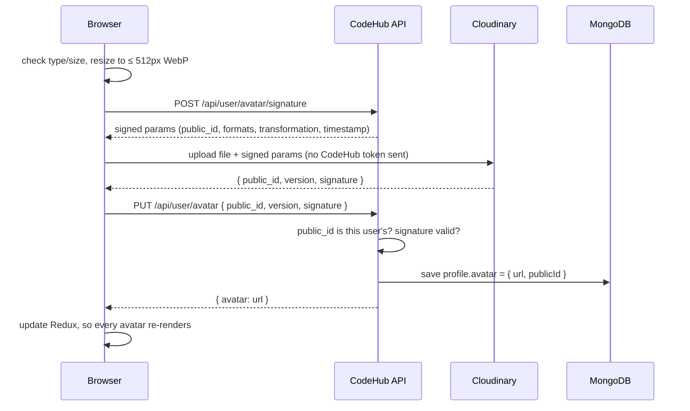

# CodeHub v2: Profile Photos with Cloudinary

Changes since **v1** (the `main` branch).

The main addition in v2 is **real profile photo uploads**. In v1 a user pasted an image URL into a text field and got a stock placeholder picture by default. In v2 users pick a photo from their device, it's stored on **Cloudinary**, and it appears everywhere their avatar is shown, resized to fit each place. Users without a photo see the first letter of their name instead of a stock image.

---

## What's new

### For users
- **Upload photo / Change photo / Remove** in the Edit Profile popup
- JPG, PNG and WebP images up to 5 MB, with a live preview and progress messages ("Preparing photo…", "Uploading…", "Saving…")
- The new photo shows up **instantly** in the navbar, the account dropdown, Settings and the profile page, without reloading
- When there's no photo, or it fails to load, the user's initial appears in place of the old placeholder image

### Under the hood
- **Direct, signed uploads.** The browser uploads the file straight to Cloudinary, so image bytes never pass through the CodeHub server. The server signs every upload parameter, so the client can't change where the file goes or what's allowed.
- **Server-side verification.** After the upload, the backend checks Cloudinary's response signature and that the file belongs to the logged-in user before saving it. It builds the stored URL itself and never trusts a URL sent by the client.
- **One file per user.** Every avatar lives at `codehub/avatars/<userId>`, so a new upload overwrites the old one and old photos never pile up. CDN caches are invalidated on overwrite.
- **Small files.**
  - The browser shrinks the photo to at most 512 px (WebP) before uploading, so a 5 MB phone photo becomes about 30–80 KB.
  - Cloudinary also caps stored images at 512×512, even if a client skips the browser resize.
- **Right size for each place.** Avatar URLs request a version cropped around the face at 2× the display size (sharp on high-DPI screens), in AVIF/WebP with automatic quality.
- **Cleanup.** Removing the photo, or deleting the account, also deletes the image from Cloudinary.
- **Rate limit.** Up to 10 avatar uploads per hour per user.

---

## How an upload works



---

## API changes

### New endpoints: `/api/user`

| Method | Path | Auth | Description |
|---|---|---|---|
| POST | `/avatar/signature` | user | Get signed parameters for a Cloudinary upload (rate limited: 10 / hour) |
| PUT | `/avatar` | user | Verify a finished upload and save it as the profile photo. Body: `{ public_id, version, signature }` |
| DELETE | `/avatar` | user | Delete the photo from Cloudinary and the profile |

### Changed behavior
- **`PUT /api/user/profile` no longer accepts `avatar`.** The photo can only be changed through the routes above.
- **Login, register and refresh responses** now include `user.avatar` (a URL or `null`), so the navbar can show the photo without an extra profile request.
- **Profile responses** return `avatar` as a URL string, or `""` when there's no photo, instead of a default placeholder URL.
- **`DELETE /api/auth/profile`** also deletes the user's photo from Cloudinary. If Cloudinary fails, the error is logged and account deletion still goes ahead.

---

## Data model change (breaking)

`user.profile.avatar` changed from a string to an object:

```js
// v1
profile: { avatar: "https://cdn.pixabay.com/...placeholder.png" }

// v2
profile: {
  avatar: {
    url: "https://res.cloudinary.com/<cloud>/image/upload/v123/codehub/avatars/<userId>",
    publicId: "codehub/avatars/<userId>"
  }
}
```

A missing `avatar` means "no photo"; the UI shows the user's initial.

### Migrating an existing v1 database
Run this once from `backend/`:

```bash
node scripts/migrateAvatars.js
```

It removes the old Pixabay placeholder (those users fall back to initials) and converts any custom avatar URL string into `{ url }`.

---

## Setup changes

1. **New dependency:** `cloudinary` (v2 SDK). Run `npm install` in `backend/`.
2. **New environment variables** in `backend/.env` (see `backend/.env.example`). You'll find all three on your Cloudinary dashboard; the free plan is enough.

   | Variable | Description |
   |---|---|
   | `CLOUDINARY_CLOUD_NAME` | Your Cloudinary cloud name |
   | `CLOUDINARY_API_KEY` | API key (safe to send to the browser, and the API does so) |
   | `CLOUDINARY_API_SECRET` | API secret. Stays on the server; it's only used to sign and verify uploads. |

3. **Existing data:** run the migration above.

---

## Files changed

**Backend**

| File | Change |
|---|---|
| `src/config/cloudinary.config.js` | **New.** Configures the Cloudinary SDK from env, always HTTPS |
| `src/services/avatar.service.js` | **New.** Upload signing, response verification, save and remove |
| `src/controllers/avatar.controller.js` | **New.** HTTP handlers for the three avatar routes |
| `scripts/migrateAvatars.js` | **New.** One-time v1 → v2 avatar migration |
| `src/routes/user.routes.js` | Added the `/avatar` routes |
| `src/middleware/rateLimiter.middleware.js` | Added `avatarUploadLimiter` (10 / hour) |
| `src/models/user.js` | `profile.avatar` is now `{ url, publicId }`, with no default image |
| `src/services/auth.service.js` | Shared `toUserResponse` adds `avatar` to auth responses; account deletion removes the Cloudinary photo |
| `src/services/user.service.js` | Profile returns `avatar.url`; profile updates no longer touch the avatar |
| `src/utils/validateReqBody.js` | Removed `avatar` from the profile update schema |
| `.env.example`, `package.json` | Cloudinary variables and dependency |

**Frontend**

| File | Change |
|---|---|
| `src/components/UserAvatar.jsx` | **New.** One avatar component used everywhere: photo at the right size, or the user's initial as a fallback |
| `src/components/profile/AvatarPicker.jsx` | **New.** Upload / change / remove UI with preview, validation and progress |
| `src/utils/resizeImage.js` | **New.** Resizes the photo in the browser with a canvas, outputs WebP |
| `src/utils/avatarUrl.js` | **New.** Builds a face-cropped, auto-format Cloudinary URL for a given size |
| `src/api/profile.js` | `uploadAvatar` (the 4-step signed upload) and `removeAvatar` |
| `src/store/slices/authSlice.js` | New `setAvatar` action updates the photo everywhere at once |
| `src/components/Navbar.jsx`, `SettingsModal.jsx`, `profile/ProfileSidebar.jsx` | Use `UserAvatar`, dropping the duplicated `` and fallback code and the hard-coded placeholder URL |
| `src/components/profile/EditProfileModal.jsx` | The "Avatar URL" text field is replaced by `AvatarPicker` |
