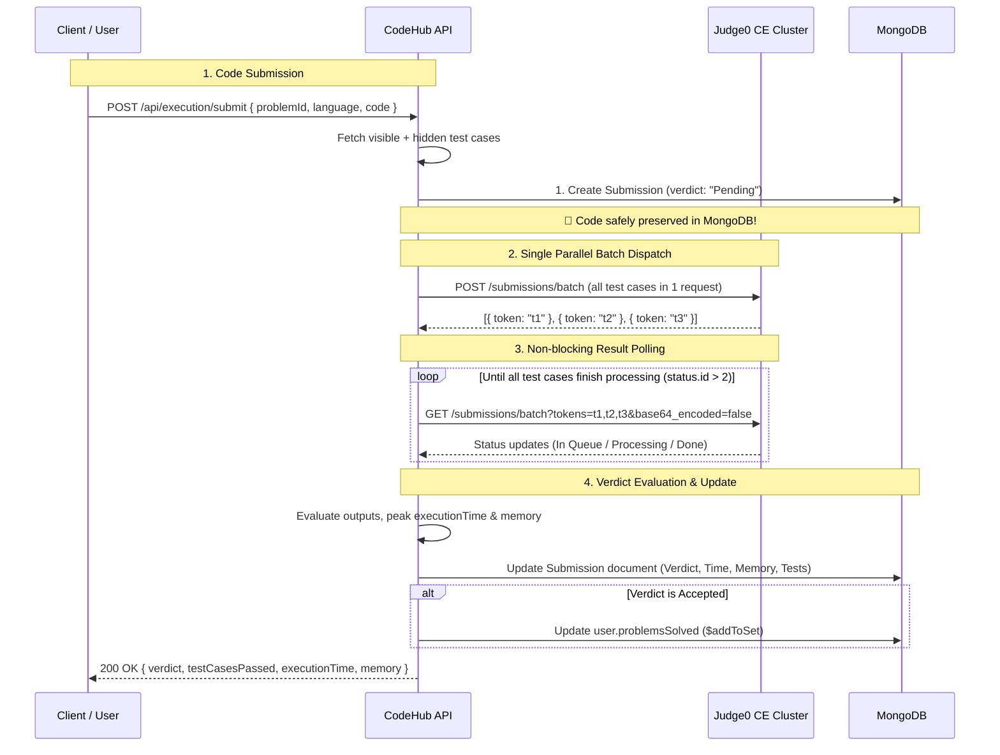

# Judge0 CE (Community Edition) Batch Submission Architecture for CodeHub

## Overview
CodeHub utilizes the **Judge0 Community Edition (CE)** free public API with **Parallel Batch Execution** for sandboxed code evaluation.

- **Base URL:** `https://ce.judge0.com`
- **Batch Endpoint:** `POST https://ce.judge0.com/submissions/batch`
- **Polling Endpoint:** `GET https://ce.judge0.com/submissions/batch?tokens=...&base64_encoded=false`
- **Auth Key:** None required (100% Free Public CE).

---

## ⚡ Execution Architecture (Parallel Batch Mode)



---

## Supported Languages & Judge0 IDs

| Language | Judge0 Runtime | Language ID |
| :--- | :--- | :---: |
| **JavaScript** | Node.js 22.08.0 | `102` |
| **Python** | Python 3.12.5 | `100` |
| **C++** | GCC 14.1.0 | `105` |
| **C** | GCC 14.1.0 | `103` |
| **Java** | JDK 17.0.6 | `91` |

---

## Component Details

### 1. Code Execution Utility — `src/utils/pistonApi.js`
Handles:
- Transforming test case inputs into batch submission format.
- Sending `POST /submissions/batch`.
- Polling `GET /submissions/batch?tokens=...&base64_encoded=false` until all `status.id > 2`.
- Standardizing outputs (`stdout`, `stderr`, `compileOutput`, `time`, `memory`, `statusId`).

```javascript
// Judge0 Status IDs:
// 1: In Queue
// 2: Processing
// 3: Accepted
// 4: Wrong Answer
// 5: Time Limit Exceeded
// 6: Compilation Error
// 7-12: Runtime Error
```

---

### 2. Submission Model — `src/models/Submission.js`
Stores:
- `userId`: Ref to `user`
- `problemId`: Ref to `Problem`
- `language`: `['javascript', 'python', 'java', 'cpp', 'c']`
- `code`: User's submitted source code
- `verdict`: `['Accepted', 'Wrong Answer', 'Time Limit Exceeded', 'Runtime Error', 'Compilation Error', 'Pending']`
- `testCasesPassed`: Count of passing test cases
- `totalTestCases`: Total test cases evaluated
- `executionTime`: Peak execution time across test cases (in seconds)
- `memory`: Peak memory consumed (in KB)
- `errorMessage`: Error trace if compilation/runtime/TLE occurred

---

### 3. Execution Controller — `src/controllers/execution.controller.js`
- **`runCode` (`POST /api/execution/run`)**: Runs user code against visible test cases in parallel batch; returns outputs for fast user debugging without saving to DB.
- **`submitCode` (`POST /api/execution/submit`)**: Persists an initial submission with `"Pending"` status (Write-First pattern for zero data loss), executes all test cases (visible + hidden) via Judge0 batch, updates the record with the final verdict/metrics, and updates `user.problemsSolved` if Accepted. In case of unexpected Judge0 / network crashes, updates the pending submission with `"Runtime Error"` instead of losing the record.
- **`getUserSubmissionsForProblem` (`GET /api/execution/submissions/:problemId` or `GET /api/problems/:id/submissions`)**: Retrieves all submissions by the logged-in user for a specific problem (sorted newest first), supporting either MongoDB `_id` or numeric `problemID`. Includes runtime, memory, test cases passed, code, and verdict.

---

### 4. Problem & Solved Management — `src/controllers/problem.controller.js`
- `POST /api/problems` (Admin Only - creates new problem)
- `GET /api/problems` (Public - paginated with difficulty/tags/search filters)
- `GET /api/problems/:id` (Public - retrieves problem by MongoDB `_id` OR human `problemID`; strips hidden test cases & reference solutions)
- `PATCH /api/problems/:id` (Admin Only - updates problem by `_id` or `problemID`)
- `DELETE /api/problems/:id` (Admin Only - deletes problem by `_id` or `problemID`)
- `GET /api/problems/user` (Auth Required - returns problems created by the logged-in admin)
- `GET /api/problems/solved` (Auth Required - returns user's solved problems with difficulty breakdown)

---

# 🎯 High-Frequency Interview Questions & Answers (Resume Deep Dive)

### Q1: Why did you use `base64_encoded=false` when fetching results from Judge0?
> **Answer:**
> By default, Judge0 can return outputs (`stdout`, `stderr`, `compile_output`) encoded in Base64 strings to safely handle non-ASCII bytes, binary data, or escape characters.
> In our platform, code submissions produce standard plaintext output. Setting `base64_encoded=false` instructs Judge0 to return plaintext UTF-8 strings directly, avoiding unnecessary `Buffer.from(str, 'base64')` CPU decoding overhead on every test case in the backend.

---

### Q2: How does Batch Submission improve scalability compared to sequential execution?
> **Answer:**
> If a problem has 10 test cases:
> - **Sequential approach:** The server sends 1 test case, waits for it, receives response, and repeats 10 times (10 round-trip HTTP requests). If each takes 600ms, total latency is **6+ seconds**.
> - **Batch approach (`/submissions/batch`):** The server sends all 10 test cases in **1 single POST request**. Judge0's worker cluster processes them in parallel across worker threads. The server polls once or twice via `GET /submissions/batch?tokens=...` and receives all 10 results in **~1 to 1.5 seconds**. This reduces network overhead by ~80% and drastically lowers user wait time.

---

### Q3: How do you prevent users from cheating and inspecting hidden test cases?
> **Answer:**
> We implement **Field Projection Filtering** at the MongoDB query level:
> - When a user fetches problem details (`GET /api/problems/get/:id`), our query explicitly excludes sensitive fields: `.select("-hiddenTestCases -referenceSolution")`.
> - Hidden test cases are only loaded internally in memory during `submitCode` on the backend, and are never returned in client HTTP responses.

---

### Q4: How is malicious user code prevented from hacking or crashing the server?
> **Answer:**
> User-submitted code is **never executed directly on our Node.js server**. 
> Instead, code execution is delegated to **Judge0**, which isolates each execution in a secure Linux sandbox using **`isolate`** (cgroups, Linux namespaces, chroot jail, and seccomp syscall filters). This guarantees:
> - Strict CPU time limits (e.g., 2.0 seconds) to prevent infinite loops / DoS.
> - Memory limits (e.g., 256MB) to prevent memory exhaustion attacks.
> - Disabled network access and restricted file system permissions inside the sandbox container.

---

### Q5: How does your Authentication & Token Rotation (RTR) system work?
> **Answer:**
> We use a **dual-token architecture with Redis**:
> 1. **Short-lived Access Token (15 mins):** Sent in the `Authorization: Bearer <token>` header for stateless API authorization.
> 2. **Long-lived Refresh Token (7 days):** Stored in an `httpOnly`, `sameSite: strict` cookie (protected from XSS attacks).
> 3. **Redis White-listing & Token Rotation:** Refresh tokens are saved in Redis (`refreshToken:<userId>`). When `/api/auth/refresh` is called, the old refresh token is invalidated, and a brand new pair is issued (Refresh Token Rotation).
> 4. **Logout Blacklisting:** On logout, the access token's remaining TTL is stored in Redis under `blacklist:<token>` so it cannot be used even if intercepted before expiration.

---

### Q6: How do you prevent duplicate entries when tracking solved problems?
> **Answer:**
> In MongoDB, we use the atomic **`$addToSet`** operator (`user.findByIdAndUpdate(userId, { $addToSet: { problemsSolved: problemId } })`). Unlike `$push`, `$addToSet` treats the array as a mathematical set, ensuring that if a user solves the same problem multiple times, the problem ID is only stored once without requiring an extra database check.

---

### Q7: What happens if a user submits code with an infinite loop or heavy memory allocation?
> **Answer:**
> - **Infinite Loop:** Judge0's watchdog process enforces the `cpu_time_limit` parameter (e.g., 2.0s) and terminates the process with **Status ID 5 (`Time Limit Exceeded`)**.
> - **Memory Exhaustion:** Judge0 enforces `memory_limit` via Linux cgroups and terminates the process with **Status ID 7+ (`Runtime Error` / SIGSEGV / SIGKILL)**.
> Our backend catches these status IDs and returns clean verdicts (`"Time Limit Exceeded"` or `"Runtime Error"`) without hanging the Node.js event loop.

---

### Q8: Why do you store the submission with status "Pending" before sending to Judge0?
> **Answer:**
> 1. **Zero Data Loss:** If Judge0 crashes or experiences a network outage, the user's submitted code and timestamp are already safely persisted in MongoDB.
> 2. **Fault Tolerance:** If an exception occurs, the submission record is updated with `"Runtime Error"` and the specific failure reason, rather than disappearing silently.
> 3. **Queue Readiness:** This decouples submission intake from execution, making it ready for asynchronous background worker queues (e.g., BullMQ / Redis).
